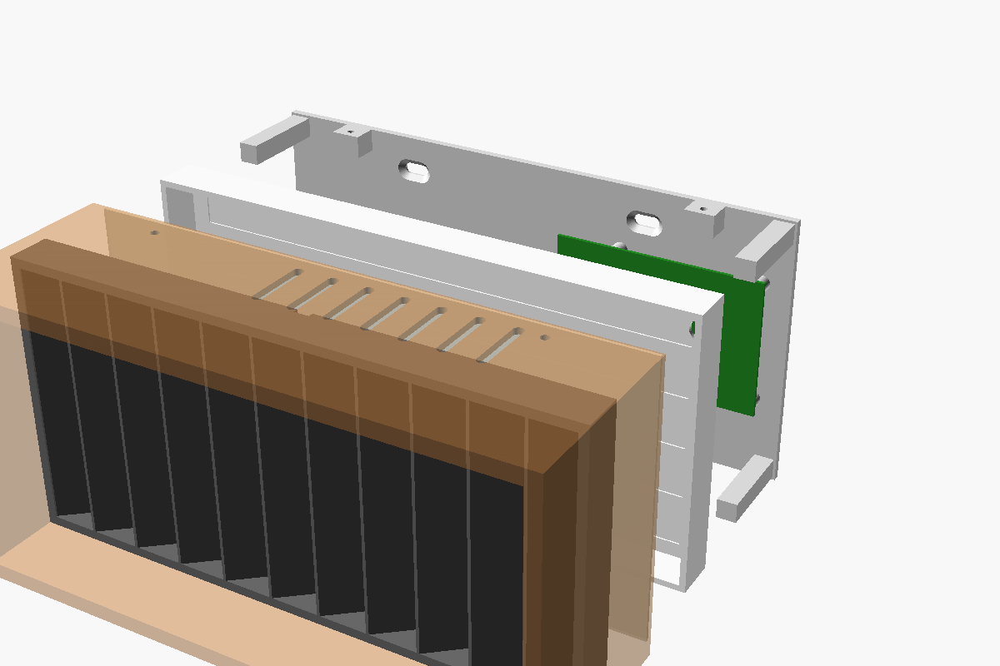

# Sunrise sconce

A small wall light that holds the whole Pi side of the project: the Pi 3B+, a Perma-Proto HAT with the LED level shifter and the DS3231 clock, the power input and the 1 m LED strip behind a diffuser. It hangs on the wall to the left of the headboard, above your pillow, and only the power cord runs down to the outlet. The SNOOZ stays across the room on Bluetooth.

`sconce.scad` is a parametric OpenSCAD model. Open it in [OpenSCAD](https://openscad.org), open the Customizer (Window > Customizer), set the values, pick a `part`, render (F6) and export the STL. With the defaults it comes out 228 × 115 × 77 mm (wide × tall × deep). That fits a 250 × 210 mm bed (MK3/MK4/Core One) but not a Prusa Mini.

## How it works

From the wall outward:

1. **Wall plate**: screwed to the wall. The Pi sits on its standoffs. It also has corner posts, tabs for the housing screws and two zip-tie loops for the power cord.
2. **Light box**: a white tray resting on the plate's corner posts. The strip is cut into 5 rows of 12 LEDs and stuck in its grooves.
3. **Diffuser**: a thin white sheet 15 mm in front of the LEDs, so the rows glow evenly instead of showing 60 dots.
4. **Louver**: a dark frame of parallel fins in front of the diffuser. It lets light out only within a band of angles, aimed at your pillow, and cuts it off before your partner's.
5. **Housing**: the visible shell. It holds those three layers against the plate's posts and is fixed with four M3 screws through its top and bottom.

The LEDs are only on for the sunrise, about 15 minutes a morning, so heat isn't a problem. Vent slots top and bottom handle the Pi.

## Measure first

- **Strip width.** `strip_w` is 12.6 mm, Adafruit's figure for the 60/m RGBW strip in its silicone sleeve. Measure yours. If it's RGB rather than RGBW the code still works, but warm white has to be mixed from red and green.
- **Where you sleep.** Lie on your back where you sleep and measure from the spot on the wall where the sconce's centre will be. Do the same for your partner:
  - `out`: from the headboard wall out to your eyes
  - `side`: along the wall, from the sconce's centre to your eyes

  Your angle toward the bed is `atan(side / out)`. With the sconce 60 cm to the side of your eyes and your eyes 35 cm out from the wall, that's 60°. Your partner at 135 cm to the side is at 75°.
- **Set the louver.** OpenSCAD's console prints the band the louver passes, such as `Louver passes light between 1 and 67 degrees toward the bed`. Light is full strength at `louver_angle` and fades to nothing at the band's edges. Choose `louver_angle` and `louver_pitch` so your angle is well inside the band and your partner's is outside it. With the defaults (50°, fins every 20 mm) you get roughly half the light at 60° and your partner gets none at 75°.
  - The closer the sconce is to your pillow, the smaller your angle and the more light you get. Hang it as near the headboard as the space allows.
  - Fins leaning more than about 50° won't print face-down. Above that, move the sconce instead.
  - If it ends up on the side wall beside the bed instead, use `louver_dir = "down"`. Then the angles are below horizontal: `atan(height of the sconce above your eyes / distance out from that wall to your eyes)`.
  - The louver is the quickest part to reprint, so try a couple of settings.

## Things to buy

| Part | Notes |
|---|---|
| Perma-Proto HAT for Pi (no EEPROM) | Holds the 74AHCT125, the 330 Ω resistor and the DS3231 |
| 74AHCT125, 330 Ω resistor, 1000 µF 6.3 V+ capacitor | From task 1.4 if not already ordered |
| 5 V 10 A power brick, 2.1 mm barrel plug | Powers the strip and the Pi. The strip can draw over 4 A at full white, which the sunrise never asks for |
| Female 2.1 mm barrel jack to screw terminal adapter | The cord's way in; zip-tied to the plate |
| Right-angle micro-USB pigtail | Pi power from the screw terminals. Keeps the Pi's own input protection, unlike feeding its 5 V pins |
| 3-pin JST SM plug and socket | Between the HAT and the strip, so the light box unplugs |
| 22 AWG wire for the row jumpers, 18–20 AWG for 5 V and GND | |
| Screws | 4 × M2.5 × 6 (Pi), 4 × M3 × 10 (housing), 2 countersunk wall screws with anchors |

## Printing

| Part | Colour | Orientation | Notes |
|---|---|---|---|
| `housing` | Any | Front face down | No supports |
| `wall_plate` | Any | Back down | No supports |
| `light_box` | White | Back down | White inside reflects more light out |
| `diffuser` | White | Flat | Or cut 2–3 mm opal acrylic to size and set `diffuser_t` to match |
| `louver` | Black | Front face down | Dark fins absorb stray light. Fins lean 50°, so use good part cooling |
| `coupons` | White | Flat | Diffuser test tiles 0.6–1.6 mm thick (tile n has n notches). Hold each over the lit strip and choose |

PLA is fine for the first prototype. Print anything you keep in PETG: PLA softens at around 55 °C.

## Wiring

Power off while wiring. The circuit is the one in task 2.2, laid out on the HAT:

- Barrel jack terminals → strip 5 V and GND (through the light box's hole, with the 1000 µF capacitor across them at the strip end), and → the micro-USB pigtail for the Pi.
- GPIO10 (pin 19) → 74AHCT125 (VCC from 5 V, enable pin to GND) → 330 Ω → strip data in.
- DS3231 on the HAT: VCC to pin 1, SDA to pin 3, SCL to pin 5, GND to pin 6 (task 2.1).
- Cut the strip on the copper pads into 5 rows of 12 and lay them as a zig-zag. The top row runs left to right, starting at the hole. The next row runs right to left, and so on, so each row's data out is next to the following row's data in. Join each turn with three short wires (5 V, GND, data). Check the arrows on the strip point the way the data flows.

## Assembly

1. Screw the wall plate to the wall, level, with the slots at the top. Use anchors unless there's a stud.
2. Put the Pi on the standoffs and the HAT on the Pi. Zip-tie the barrel adapter to the loops, with the cord leaving through the notch in the housing.
3. Lay the housing face-down on a table. Drop in the louver (notch at the top, at the back), then the diffuser, then the light box with its LEDs facing down.
4. Hold the housing up to the wall, plug the strip into the HAT, slide the housing over the plate and fit the four M3 screws through the top and bottom.

## Keeping the bedroom dark

The light box is closed except for the wire hole, so cover that with tape once the wire is through. Remove or cover the DS3231 board's red power LED. The Pi's red and green LEDs can be switched off in software. That will come with the LED work (task 2.2), so until then they glow faintly through the vent slots.

## Wood version

Once the prototype is right, the housing can become a hardwood box: mitre the four sides, cut a rabbet for the front lip, and mount it on a small French cleat instead of the wall screws. The wall plate, light box, diffuser and louver stay printed and fit inside the same opening. The louver can also be made from thin wood slats set in angled kerfs. Wood doesn't block Bluetooth or Wi-Fi. Avoid metal near the Pi's end of the box.
